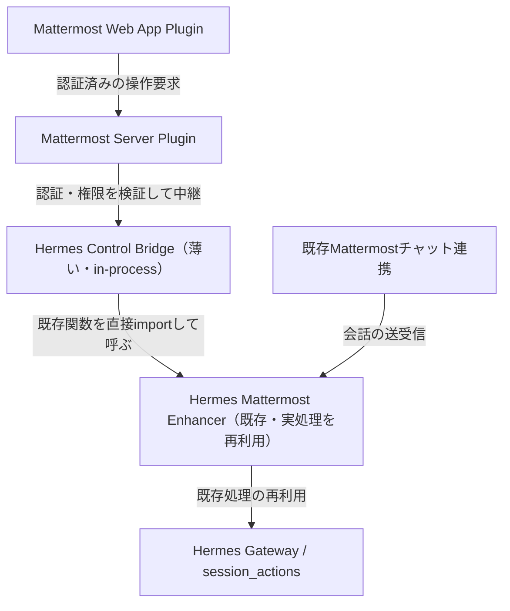

# Mattermost Hermes Console 仕様書

- 文書バージョン：0.3（実装に合わせて更新。v0.2 からの差分は §0.1 と §5）
- 作成日・情報確認日：2026-10-11（日本時間）／実装反映：2026-10-27
- 状態：**実装済み**（plugin `0.3.1` を実機 Mattermost に導入）
- 仮称：Mattermost Hermes Console
- 最初の接続対象：Hermes Agent
- 想定読者：実装担当者、レビュー担当者、実装を引き継ぐAI
- 形式：要件・画面・連携方式・受入条件をまとめたMarkdown仕様書

改訂点は REVIEW.md を参照。v0.1 の「未確認」はすべて実測で埋め、ブロッカー5件を解消済み。

## 0. 固定した実環境（Step 1 実測）

| 項目 | 値 |
| --- | --- |
| Mattermost | mattermost/mattermost-team-edition、v11.11.0、127.0.0.1:8065、SiteURL https://<your-mattermost-host> |
| Hermes | v0.21.6+509.gf925b01（CalVer 2026.9.24）、commit f925b01791 |
| Mattermost adapter | `~/.hermes/hermes-agent/plugins/platforms/mattermost/adapter.py` |
| Enhancer | a-nomad-studio/hermes-plugin-mattermost-enhancer（MIT、未導入） |
| セッション設定 | group_sessions_per_user: true / thread_sessions_per_user: false |

実装開始時に Mattermost image digest と Hermes commit を pin し、対応表に記録する。

## 0.1 実装状況（2026-10-27 時点）

v0.2 は「右サイドバー(RHS)に操作UI」を前提にしていたが、実装は**投稿パネル方式**に変わった。
RHSはスレッド表示と枠を奪い合うため、パネルをチャンネル/スレッドへの通常投稿として置き、
その投稿を書き換えることで状態と結果を1か所に保つ。

| 項目 | 実装 |
| --- | --- |
| 入口 | App Bar（現在のスレッド or チャンネル直下を対象にパネル投稿）／投稿メニュー「Hermes Consoleで開く」 |
| UI | **投稿パネル**（attachments 3枚: モデル / セッション / 結果）。RHSは未使用 |
| 操作 | モデル切替（Provider → モデル → 適用）、会話リセット、コンテキスト圧縮、状態を更新 |
| 状態 | `/hermes-status` は gateway の `/status` 本文を**そのまま**投稿（フッター付加なし） |
| 言語 | gateway の `display.language` に追従（ja/en、fallback `en`）。bridge `/language` 経由 |
| Bridge | Hermes gateway プロセス内。`/health` `/agents` `/agents/{id}/models` `/language` `/status` `/session` `/session/actions` |
| 排他 | plugin: 操作予約＋投稿単位 mutex / bridge: `_running` レジストリ＋冪等キー24時間 |
| 未実装 | パネルでのコンテキスト使用量表示、`generation`/`revision`、非同期 operations API、RHS、Native Mobile |
| 依存 | Enhancer は**未導入**。bridge は `gateway.session` / `hermes_cli` を直接参照する（§7.1） |

## 1. 目的と結論

MattermostでHermesを利用する際、モデル切替、会話リセット、コンテキスト圧縮、状態確認のたびにコマンドを入力する手間をなくす。

MattermostのApp Barから開く右サイドバーに操作UIを追加する。会話本文の送受信は既存のMattermostチャットとHermes連携を継続利用し、今回のプラグインは会話の設定・状態を扱う。

初期実装はHermesだけに接続する。接続部分をAdapterとして分離し、将来自作Agentを追加できる構造にする。

### 1.1 設計上の決定

| 決定 | 内容 |
| --- | --- |
| 構成 | 既存Enhancerを土台にし、不足分だけ新設する。BridgeはEnhancerの `session_actions.py` を直接importし、ロジックを写経しない |
| セッション | Actor込みの per-user マッピングを初期から採用（実設定に合わせる） |
| パッチ | Enhancer の shell patch を当てる前提。導入時に SKIP/再検証を実施 |
| 入口 | `registerAppBarComponent` の action で**パネル投稿を作る**（RHSは使わない。§0.1） |

## 2. 背景・既存実装の扱い

### 2.1 Hermes Mattermost Enhancer

参照：［S1］［S2］［S3］（3つは同一リポジトリ。［S1］は GitHub rename）

Enhancerにはモデル選択、会話リセット、コンテキスト圧縮、承認・質問カード、Typing・スレッド配送・footer編集マージ、チャンネル→スレッドのモデル継承がある。

- `session_actions.py` は `gateway.run._gateway_runner_ref()` と `_session_model_overrides` を直接操作する。内部属性依存なので対象コミットを固定し、Hermes更新時に互換性を検証する。
- callback server は `POST /mattermost/callback`（Interactive Message、`MATTERMOST_CALLBACK_SECRET` の HMAC-SHA256署名で検証）と `POST /mm-command`（Slash Command、コマンド別トークンで検証）を持つ。**認証・応答形式とも実装済み**。
- 規約：プラグインは session key を手で組まず、`build_session_key()` を唯一の真源にする。
- `scripts/hermes-mattermost-enhancer.sh` が `gateway/run_inbound.py`（E-P2 Clarifyセッション分裂）と `gateway/run_startup.py`（E-P4 再起動時セッション串台）をパッチする。
  Step 1 で両者の `old_string` が現ソースで各1回のみ一意マッチすることを実測確認済み。
  Hermes 更新のたびに再検証し、SKIP 時はパッチを書き直す。
- 導入時は `register_platform()` の last-writer-wins に注意。bundled adapter の `apply_yaml_config_fn` / `standalone_sender_fn` / `validate_config` / `is_connected` / メッセージ長設定をすべて引き継ぐ。1つでも欠けると機能が気づかないうちに動かなくなる。

### 2.2 その他の参考実装

| 参照元 | 役割 | 位置付け |
| --- | --- | --- |
| Hermes Mattermost Integration［S4］ | Slash Commandを通常投稿へ橋渡しする。Go の `mattermost-plugin/`（plugin id `com.hermes-agent.slash-bridge`、min_server_version 9.0.0）を持つ | Server Plugin の構成参考。ライセンスは NOASSERTION のため確認必須 |
| Mattermost Agents Plugin［S5］ | Mattermost独自のAgent UI（Go / 254 stars） | RHS・操作配置の参考 |
| Mattermost Web App Plugin SDK［S6］ | 拡張API | UI実装に使用 |

SDK確認済み関数：`registerAppBarComponent`（iconUrl, action, tooltipText, supportedProductIds, rhsComponent, rhsTitle）、`registerChannelHeaderButtonAction`、`registerRightSidebarComponent`、`registerPostDropdownMenuAction`。

### 2.3 Mattermost の制約（実装時に必ず守る）

| 制約 | 値 |
| --- | --- |
| action_id | 純字母のみ（`-` `_` 不可） |
| attachment あたり actions | 最大5 |
| メッセージあたり attachments | 最大5 |
| select コンポーネント | デフォルト選択不可。現在値を `name` にプレースホルダ表示し、選択肢に印を付ける |
| Slash Command 応答 | ユーザー身份で出るため、可視内容は Bot API で投稿 |

## 3. 対象範囲

### 3.1 MVPで実装する機能

| ID | 機能 | 利用者ができること |
| --- | --- | --- |
| F-01 | Consoleを開く | App Barの入口から右サイドバーを開く |
| F-02 | 操作対象の選択 | 現在のチャンネル、または投稿メニューから特定のスレッドを選ぶ |
| F-03 | 状態の表示・更新 | 接続状態、現在モデル、会話状態、コンテキスト使用状況を確認 |
| F-04 | モデル切替 | 設定済みのモデル候補から選択して適用 |
| F-05 | 会話リセット | 確認画面を経て、対象のHermesセッションをリセット |
| F-06 | コンテキスト圧縮 | 対象セッションの古い会話を要約し、処理結果を確認 |
| F-07 | 操作結果・エラー表示 | 実行中／成功／失敗／結果不明を区別して表示 |

### 3.2 MVPの対象外

- PGX上の推論サーバー起動、モデル重みのロード／アンロード、GPU監視。
- 独自の会話入力欄、チャット履歴の複製、別のAgent実行エンジン。
- Telegram／Discord／Matrix連携。
- 自作Agentの登録・管理、タスク管理、ログ閲覧、Quick Actions。
- 承認・質問カードの独自再実装。
- スマートフォンのMattermostネイティブアプリへの独自UI追加。

「モデル切替」はHermesが会話で使用するモデル／Provider設定の変更である。接続先のllama-swap等のロードは接続先サービスの責務として扱う。

## 4. 利用者・権限・会話の単位

### 4.1 利用者

- 管理者：接続先、対象Bot、利用できるユーザー／チャンネル、秘密情報を設定する。
- 操作者：許可された会話の状態確認と操作を行う。
- その他のメンバー：既存チャットを利用する。Consoleの操作権限は別に判定する。

### 4.2 会話の識別

外部APIでは次を組み合わせて対象を指定する。

| 項目 | 意味 |
| --- | --- |
| `agent_id` | 接続対象。MVPではHermesの1接続 |
| `channel_id` | MattermostのチャンネルID。DMも対象になり得る |
| `root_post_id` | スレッドの親投稿ID。チャンネル直下の場合は `null` |

これをHermes内部の `session_key` に変換する責務はHermes Adapterが持つ。UIが内部キーを組み立てない。

**重要（実測に基づく）**：`group_sessions_per_user: true` のため、チャンネル直下のセッションは
ユーザーごとに分離される（スレッドのみ共有）。したがって **Actor を経路全体で必ず持ち回る**。
Adapter は常に `user_id` を `build_session_key()` に渡す。チャンネル直下で Actor を省くと別セッションに流れる。

```
実測キー例
  channel直下 / ユーザーA : agent:main:mattermost:group:<ch>:<user-a>
  channel直下 / ユーザーB : agent:main:mattermost:group:<ch>:<user-b>   ← 分離
  thread内 / ユーザーA   : agent:main:mattermost:thread:<ch>:<root>         ← 共有
  thread内 / ユーザーB   : agent:main:mattermost:thread:<ch>:<root>         ← 同一
```

共有範囲（チャンネル直下=ユーザー別 / スレッド=共有）をUIに明示する。
`thread_sessions_per_user` を true に変えた場合はスレッドもユーザー別になるため、UI表示も追随させる。

### 4.3 権限の判定

すべての読み取り・変更でServer Pluginが次を検証する。

1. Mattermostが認証したユーザーであること。
2. 対象チャンネルへのアクセス権があること。
3. チャンネル・ユーザーが管理者の許可設定に含まれること。
4. スレッド指定時、その親投稿が対象チャンネルに属すること。
5. Agent側でも対象のマッピングと操作権限が成立すること。

ブラウザーの `user_id` を信頼しない。ActorはMattermostの認証コンテキストから取得し、要求本文には入れさせない。System Admin権限は要求しない。

## 5. 画面仕様

### 5.1 入口と対象選択（投稿パネル方式）

- App Bar の action で、現在のチャンネル（スレッドを開いていればその root）を対象に
  **パネル投稿を1件作る**。RHSは使わない（スレッド表示と枠を奪い合うため）。
- 投稿メニュー「Hermes Consoleで開く」は、返信投稿なら root に解決して同じパネルを作る。
- パネルは常設投稿。操作すると**同じ投稿を書き換える**（busy 表示・結果・選択状態）。
- 対象は投稿の props（`channel_id` / `root_post_id` / `target_user`）に固定する。
  チャンネルを移動しても、その投稿の対象は変わらない。
- コマンドの対象は**打った場所そのもの**。スレッド内なら `RootId`、チャンネル直下なら空。
  「直近に自分が投稿したスレッド」を推測しない（チャンネル直下の `/hermes` が上のスレッドに入るバグの原因だった）。
- DM のトップレベルは adapter が自動スレッド化しないため、**root を推測しない**（明示 root のみ）。
- チャンネル種別が取得できない場合は、別セッションを触らないよう**操作を送らない**。
- 許可されないユーザー／チャンネルではパネルを作らず、1行の説明を返す。

### 5.2 Consoleの表示順

| attachment | 項目 | 内容 |
| --- | --- | --- |
| モデル | 現在モデル / 範囲 | Provider表示名・モデル表示名、チャンネル直下かスレッドか |
| モデル | 操作 | Provider 選択 → モデル選択 → **適用**（attachment あたり actions は最大5） |
| セッション | 稼働状態 / 会話 | 待機中・応答中・未確認、セッションの有無 |
| セッション | 操作 | 会話をリセット / 会話を圧縮 / 状態を更新 |
| 結果 | 直前の操作 | 成功・失敗・結果不明。本文（gatewayの返答）を優先して表示 |

- **コンテキスト使用量はパネルに出さない**（v0.2 の項目6は未実装）。`/hermes-status` と `/status` で確認する。
- パネル本文には手順説明（①②③）を書かない。セレクトと「適用」で足りる（要件）。

- 操作の結果は**スレッドへの1件の投稿**として残す（`/model` 等のゲートウェイ既定挙動に合わせる）。
  パネル自体は常設し、成功後も `busy` を解除して再操作できる。操作の履歴はパネルではなく投稿側で追う。
- モデル変更は2段階（Provider → モデル → 適用）。Provider 変更時はモデル選択をクリアし、
  モデル未選択のあいだ「適用」を無効化する。attachment あたり actions は最大5のため、
  2段の選択肢は「モデル」attachment に、会話操作は「セッション」attachment に分ける。
- Mattermost の `ActionMenu` は options をコンストラクタで確定し、`key={action.id}` で管理される。
  そのため Provider 変更時は**モデル select の action id にプロバイダーを埋め込む**（`selectmodel<provider>`）。
  id が変わると再マウントされ options が作り直される。投稿の再投稿は不要（他端末への通知を避ける）。
- ラベルは gateway の `display.language` に追従する（ja/en、fallback `en`。§0.1）。
- モデル名は原表記を保持する。
- 成功するまで現在モデルを確定表示へ切り替えない。
- **自動ポーリングはしない**。状態は「状態を更新」で取り直す（v0.2 の10秒間隔は未実装）。
- 入力キーワード（`状態`/`モデル`/`リセット`/`圧縮`）は翻訳しない（利用者が打つ別名）。
- 遅れて返った旧対象のレスポンスを、新しい対象の表示へ反映しない。
- Keyboard操作・Focus表示・読み上げ用ラベルを付け、色だけで状態を伝えない。
- ボタンの無効化は排他制御の代替ではない（複数ブラウザー・複数利用者に適用）。

## 6. 操作の動作仕様

### 6.1 モデル切替（F-04）

1. Adapterから許可されたモデル候補を取得する。
2. 利用者が候補を選び、「適用」を押す。
3. サーバーが対象・権限・現在のセッション世代と状態を検証する。
4. Hermesの対象セッションに設定を適用する。
5. 状態を再取得し、新しいモデルと結果を表示する。

- 候補は `providers:` / `custom_providers:` から Provider と Model の組み合わせで列挙する。同名モデルを混同しない。
- APIキー、接続先秘密情報はブラウザーに返さない。
- 会話履歴は維持し、ほかのセッションには影響させない。
- Agentが応答中・ツール実行中・承認／質問待ちなら変更を拒否する（判定は `_is_session_running` / `_peek_session_state`）。
- 切替は次のリクエストに使う設定の変更を意味する。候補一覧にあることだけで推論サーバーの稼働を保証しない。
- 設定保存に失敗した場合、完全成功と表示しない。失敗／部分適用として示し、状態を再確認する。
- 永続化は `async_session_store.set_model_override()` に非機密のみ（model / provider / base_url）。api_key は永続化しない。

### 6.2 会話リセット（F-05）

- 確認画面にチャンネル／スレッドの対象を表示する。
- 確認文：「この会話の文脈をリセットし、会話別のモデル設定を解除します。Mattermostの投稿は残ります。」
- 現在のセッションと会話別の上書き設定をリセットする。
- 長期メモリ、保存済みファイル、ほかの会話の削除は含めない。
- リセット後の実際のモデルを状態APIから取得する。チャンネル設定の継承がある場合も、推測したモデル名を表示しない。
- 応答・ツール実行・承認／質問待ち・圧縮中は拒否する。
- 未作成のセッションには「リセットする会話がありません」と表示し、勝手に新規会話を作らない。

画面の名称は「会話をリセット」とし、「新規スレッド作成」とは区別する。

### 6.3 コンテキスト圧縮（F-06）

- 確認文：「古い会話を要約して、この会話を続けます。細かな表現が要約される場合があります。」
- Hermesの既存圧縮処理（`_handle_compress_command`）を利用する。Plugin側で独自にLLMへ要約を依頼しない。
- `_handle_compress_command(event: MessageEvent)` は session_key ではなく MessageEvent を要求する。Bridge は最小の合成イベントを組む。ここが最も難しい。
- ロックは `_session_has_compression_in_flight(session_key)` を使う。処理中は同じ会話のモデル変更・リセット・追加圧縮を無効化する。
- 履歴が短い場合は「圧縮は不要でした」と表示する。
- 成功後は状態を再取得する。使用率は取得できた場合だけ更新する。
- `--preview` と `here N` は既存。MVPで出すかは実装時に選ぶ（既定は出さない）。

### 6.4 状態表示（F-03）

- `/hermes-status` は gateway の `/status` を**同一コードパスで実行し、本文をそのまま投稿する**。
  コンソール独自のフッター（範囲・会話）は付けない（要件）。
- 取得が空／失敗なら1回リトライし、それでも駄目なら
  「⚠️ statusを取得できませんでした（ブリッジが応答しません）。」を1行投稿する。
  パネルへのフォールバックはしない（コマンドの通常出力に見えてしまうため）。

Agentの接続確認と会話の稼働状態を別々に返す。

- Agent接続確認が成功しても、LLMの疎通成功と同義にしない。
- セッションがなければ `session_exists=false` を返す。
- 参照系のAPIがなく追加実装が必要な値は、Bridgeに読み取り処理を追加する。
- 投稿のFooterを解析して現在状態を推定する方式を主要な取得方法にしない。
- コンテキスト値の欠落は許容する。現在モデル・会話の存在・操作可能状態の取得はMVPの必須条件とする。

## 7. システム構成



### 7.1 各層の責務

| 層 | 言語 | 責務 |
| --- | --- | --- |
| Web App Plugin | React / TypeScript | App Bar・投稿メニューの入口だけ（パネル自体は投稿） |
| Server Plugin | Go | Mattermost認証・アクセス権確認、設定管理、Bridgeへの中継、パネル描画・操作予約・結果表示 |
| Hermes Adapter | Go側の接続インターフェース | 共通データ形式への変換、Bridgeとの通信（`server/bridge_client.go`） |
| Hermes Control Bridge | Python（in-process） | セッション解決、状態取得、`/status` 中継、排他制御、冪等記録。`gateway.session` と `hermes_cli` を直接参照 |
| Hermes Gateway | 既存実装 | 会話・モデル設定・圧縮・`/status` の実処理 |

Control BridgeはHermesのセッションを所有するプロセス内で動作する。別PythonプロセスからGatewayのメモリ内状態を直接参照できる前提にしない。
Enhancer は**未導入**で、bridge は Enhancer の `session_actions.py` を import しない（v0.2 の前提から変更）。
gateway プロセスでは `register()` 時点で HTTP bridge を起動し、runner は最初のリクエスト時に bind する。

Adapterは `getModels`、`getSessionState`、`switchModel`、`resetSession`、`compressSession` を定義する（本製品の新設インターフェース。既存Hermes APIの名称ではない）。

### 7.2 既存プラグインとの共存

MVPは1つの確認済みAdapter構成（Enhancer）を選び、競合する上書きを重ねない。
Enhancer と tonymorello Integration の同時導入は未確認。MVPは Enhancer のみとする。

既存の承認・質問カードは現在の連携経路を維持する。Consoleはそれらの待機状態を表示して会話変更を抑止する。

## 8. API設計案

**以下は本製品が新設するAPI。HermesまたはEnhancerに現存するAPIと解釈しない。**

`/plugins/<plugin_id>/api/v1`（plugin_id は開発開始時に名前空間とともに決める）。以降は相対パス。

### 8.0 実装済みのエンドポイント（plugin 0.3.1）

| 層 | Method | Path | 機能 |
| --- | --- | --- | --- |
| Mattermost plugin | GET | `/plugins/com.nicox.hermes-console/api/v1/health` | 稼働確認 |
| Mattermost plugin | POST | `/plugins/com.nicox.hermes-console/api/v1/panel` | パネル投稿を作る |
| Mattermost plugin | GET | `/plugins/com.nicox.hermes-console/api/v1/agents/{id}/models` | モデル候補（ブラウザー用） |
| Mattermost plugin | GET | `/plugins/com.nicox.hermes-console/api/v1/agents/{id}/session` | 対象セッションの状態 |
| Bridge | GET | `/health` | `{"status":"ok","agent_id":"hermes"}` |
| Bridge | GET | `/agents` | Agent一覧とCapabilities |
| Bridge | GET | `/agents/{id}/models` | モデル候補 |
| Bridge | GET | `/agents/{id}/language` | gateway の `display.language`（ja/en） |
| Bridge | GET | `/agents/{id}/status` | gateway `/status` の本文（`channel_id`/`root_post_id`/`user_id`/`chat_type`） |
| Bridge | GET | `/agents/{id}/session` | セッションの存在・稼働状態・現在モデル |
| Bridge | POST | `/agents/{id}/session/actions` | `switch_model` / `reset_session` / `compress_session` |

Bridge は `127.0.0.1:18066`、`Authorization: Bearer <BridgeToken>` で保護する。
**v0.2 の `/operations` 非同期APIは未実装**（操作は同期POSTで、timeout時は bridge 内で実行継続）。

### 8.1 操作要求の例

```json
{
  "target": { "channel_id": "example-channel-id", "root_post_id": "example-root-post-id" },
  "expected_generation": 3,
  "expected_revision": 18,
  "action": "switch_model",
  "model_key": "local-primary:model-a",
  "idempotency_key": "example-client-generated-uuid"
}
```

- `action`：`switch_model` / `reset_session` / `compress_session` のみ。
- `model_key`：モデル候補APIが返す不透明なID。
- `expected_generation`：リセット等で世代が変わった会話へ古い操作を適用しないための値。
- `expected_revision`：**Hermesに無い概念。Bridge側で新設する**。設定・状態が変化していた場合に再確認させる。時刻や通常の計測更新だけでは増やさない。
- `idempotency_key`：同じ要求の再送で副作用を重複させないための値。
- ActorはServer Pluginが付与する。要求本文に利用者IDを指定させない。

### 8.2 状態レスポンスの例

```json
{
  "target": { "channel_id": "example-channel-id", "root_post_id": "example-root-post-id" },
  "session_exists": true,
  "generation": 3,
  "revision": 18,
  "agent_connectivity": "reachable",
  "activity": "idle",
  "model": { "key": "local-primary:model-a", "display_name": "Model A", "provider_display_name": "Local Primary", "source": "session_override" },
  "context": { "used_tokens": null, "limit_tokens": null, "percent": null, "measurement": "unavailable" },
  "capabilities": { "switch_model": true, "reset_session": true, "compress_session": true },
  "allowed_actions": ["switch_model", "reset_session", "compress_session"],
  "observed_at": "2026-10-11T07:00:00Z"
}
```

`capabilities` はAdapterが実装している機能、`allowed_actions` は現在の利用者・会話状態で実行できる機能。API自身でも同じ判定を行う。

`activity` は `idle` / `running` / `awaiting_approval` / `awaiting_input` / `compressing` / `unknown`。不明な状態では変更操作を許可しない。

### 8.3 操作応答とエラー

- 非同期処理の受付は `202` と `operation_id` を返す。
- 完了状態は `succeeded` / `failed` / `unknown`。進行中は `pending` / `running`。
- 圧縮処理をHTTPリクエストの接続時間だけで管理しない。
- 操作結果にも対象・Actor・開始／終了時刻を保持する。
- 操作結果の読み取りでも権限を再確認する。

| HTTP | Error code例 | UIの扱い |
| --- | --- | --- |
| 401 | `unauthenticated` | 再ログインを促す |
| 403 | `forbidden` | 操作権限がない旨を表示 |
| 404 | `target_not_found` | 対象を再選択 |
| 409 | `session_busy` / `stale_session` | 状態を更新して再確認 |
| 422 | `unsupported_action` / `invalid_model` | 候補・機能を更新 |
| 502/503 | `hermes_unavailable` | 接続不可を表示 |
| 504 | `outcome_unknown` | 結果を確認し、変更操作を自動再送しない |

生の例外や接続先の秘密情報を利用者に表示しない。

## 9. 排他制御・障害時の動作

### 9.1 会話単位で直列化する

- 同じセッションの変更操作は同時実行しない。
- 排他制御はBridge／Gateway側で行い、Hermesの通常会話実行と競合しないようにする。
- UIでボタンを無効にするだけでは不十分。複数ブラウザー・複数利用者にも適用する。
- 圧縮中は `_session_has_compression_in_flight` を必ず参照する。
- 別のセッションは独立して操作できる。
- 状態確認と操作実行の間に会話が開始された場合は、実行直前の判定で拒否する。

### 9.2 重複・再起動・結果不明

- 同じActor・対象・Idempotency Key・内容の要求は同じ操作結果に結び付ける。
- 同じKeyで異なる内容の要求は拒否する。
- 重複排除は bridge の**メモリ内**（`_idempotency`、TTL 24時間）。**SQLite 永続化は未実装**で、
  bridge 再起動で消える。
- 実行中の操作は `_running` レジストリで追跡し、timeout 後の再送は `409 in_progress` を返す。
  待機終了と実行終了は別で、遅れて完了した結果は callback で冪等キャッシュへ記録する。
- 再起動時に実行途中だった処理は、検証できなければ `unknown` とし、自動再実行しない。
- 中継前に失敗して未実行と判断できる場合と、実行した可能性がある場合を区別する。
- 対象の現在状態を取得できても、過去の操作が成功したか不明な場合は操作結果を勝手に成功へ変えない。
- 圧縮の完了期限はAdapterの処理特性に合わせる。期限超過だけで処理が停止したとは扱わない。

## 10. 配置・設定・ログ

### 10.1 接続経路

ブラウザーはMattermostの同一OriginのServer Pluginだけに接続する。HermesのBot Token・Provider API Key・Bridge認証情報をブラウザーに渡さない。

Mattermost は Docker、Hermes はホストで動く。コンテナ内の `localhost` が Hermesホストを指すとは扱わない。callback 到達には `host.docker.internal`（Enhancerの `.env.example` 準拠）を使い、HTTPS等で保護する。
compose に `MM_PLUGINSETTINGS_ENABLEUPLOADS` が無いため、System Console でプラグインアップロードを有効化する手順を README に含める。

Bridgeは固定のServer Pluginを信頼する内部APIとし、共有サービス認証で接続元を検証する。サービス認証が成立した要求だけ、Server Pluginが付与したActorを受け付ける。接続先は管理者設定に限定する。

### 10.2 管理設定案

| 設定 | 内容 |
| --- | --- |
| `BridgeURL` | bridge の接続先（既定 `http://127.0.0.1:18066`） |
| `BridgeToken` | 共有サービス認証。サーバー側のみで保持 |
| `AllowedUsers` | カンマ区切りの user_id。未設定時は操作不可 |
| `AllowedChannels` | カンマ区切りの channel_id。未設定時は操作不可 |
| `HermesBotID` | 既存連携との対応確認に使用 |
| 接続タイムアウト | 操作 10分 / status 25秒（bridge 内部待機は status 20秒） |
| bridge 復帰待ち | パネル描画時 3秒×30回（最大90秒） |
| 状態更新間隔 | 自動ポーリングなし（手動更新） |
| API／Bridgeバージョン | 互換性チェックは未実装 |

### 10.3 記録する内容

操作ID、Actor、対象、操作種別、選択モデル、処理状態、開始／終了時刻、エラー種別を記録する。チャット全文・APIキー・Tokenは操作ログに含めない。保持24時間、ローテーションあり。

状態を読むたびにチャンネルへ投稿しない。結果表示はConsoleを中心とし、既存Hermes処理が投稿する結果は重複投稿しない。直近の変更操作をConsoleで表示できるようにする。

## 11. 対応環境・配布物

### 11.1 初期対応案

- 実環境のMattermost Web版およびDesktop版。
- Mattermost image は digest で pin する（`latest` 追従を避ける）。最低Mattermostバージョンは実機 v11.11.0 を基準に確定。
- Hermes と Enhancer の対象コミット／バージョンを固定し、対応表に記載する。
- Server Plugin の実行バイナリは linux-amd64 向けにビルドする。PGXのCPUとMattermostホストのCPUを同一視しない。
- Native Mobile対応は別途検討する。

### 11.2 実装時の成果物

1. Mattermost Plugin の Bundle: `server/dist/com.nicox.hermes-console-<version>.tar.gz`（linux-amd64）。
2. Hermes Control Bridge: `bridge/`（`~/.hermes/plugins/hermes-console-bridge` にリンクして gateway で動かす）。
3. ソースコードと依存の固定情報。
4. README：導入、設定、更新、削除、障害切り分け、アンインストール／ロールバック手順（**未整備**）。
5. 対応バージョン表と検証結果（本書 §0/§12）。
6. 既存コードを再利用した範囲とライセンス表記（Enhancer は MIT だが**未使用**。［S4］は NOASSERTION のため確認）。

## 12. 受入条件

| ID | 条件 | 検証方法 |
| --- | --- | --- |
| A-01 | 4操作のためにコマンドを手入力しない | Consoleだけでモデル変更・リセット・圧縮・状態更新 |
| A-02 | 選んだ会話だけに操作が適用される | 同一チャンネルの2スレッドで別モデルを設定 |
| A-03 | RHSを開いてもスレッド対象を保持する | 投稿メニューから開き、対象表示と実際の操作先を確認 |
| A-04 | チャンネル移動後に旧対象を誤操作しない | 移動・遅延レスポンス・確認画面表示中の移動で確認 |
| A-05 | リセットでMattermost投稿が消えない | 操作後のセッション・モデル・投稿履歴を確認 |
| A-06 | 圧縮後も同じ会話を継続できる | 圧縮前の決定事項を圧縮後の会話で確認 |
| A-07 | 応答・ツール実行・承認／質問待ちと競合しない | 各状態で変更を要求し、Gateway側でも拒否されることを確認 |
| A-08 | 同時操作と再送で副作用を重複させない | 2ブラウザー、同じKeyの再送、Bridge再起動で確認 |
| A-09 | 許可されないユーザー／対象はAPIでも拒否 | UIを経由せず要求し、閲覧・変更・操作結果取得を確認 |
| A-10 | 対象IDのすり替えを拒否する | 別チャンネルの親投稿IDを指定して確認 |
| A-11 | 秘密情報がクライアントに渡らない | API応答・Bundle・ログ・ブラウザー通信を確認 |
| A-12 | 障害と結果不明を区別する | 切断を操作受付前／受付後に発生させて確認 |
| A-13 | 不明なコンテキスト値を0%と表示しない | 計測値なしの応答で確認 |
| A-14 | 状態取得が会話を作成しない | 未作成対象を繰り返し閲覧して確認 |
| A-15 | 固定した実環境で導入・更新できる | Web版・Desktop版、Server Plugin BundleとBridgeを実機検証 |
| A-16 | **チャンネル直下でActorが正しく効く** | 2ユーザーが同一チャンネル直下で別モデルを設定し、互いに影響しないことを確認 |
| A-17 | パッチが SKIP した場合に検知できる | Hermes更新後にスクリプトを走らせ、SKIP時に導入を中断 |

機能ロジック・権限・対象解決・重複防止は意味のある自動テストを作る。外観だけの変更に実装をなぞるテストを増やさず、画面の導線は実機で確認する。

### 12.1 検証状況（2026-10-27、plugin 0.3.1）

- 自動テスト: Go **48 pass** / bridge **36 pass**（`go test ./...`、`pytest bridge/tests`）。
- 実機で確認済み（plugin 0.3.2）: 起動直後の bridge listen、`/models`、`/language`、`/hermes-status` の本文が `/status` と一致、
  パネル投稿の生成、モデル切替（Provider→モデル→適用→gateway が `Model switched to ...` を返し、パネルの Current model が更新）、
  リセット（`Conversation reset`）、圧縮（`Not enough conversation to compress`）、
  DM のパネル（`root_id=""`・`Channel root (per user)`）、busy 中の再クリック拒否、plugin 0.3.2 の有効化。
  操作はブラウザーの代わりに Mattermost の post-action API へ同じ `context` を送って確認した。
- App Bar・投稿メニューの実クリック（ブラウザー操作）、ja 表示の実画面（gateway が `en` のため）、
  A-02/A-05/A-06/A-08/A-16 の複数ユーザー・複数スレッドでの確認は未確認。
- `display.language` の変更は gateway プロセスにキャッシュされるため、再起動が必要。
  System Console 以外（`PUT /api/v4/config`）で allowlist を変えた場合も、plugin の disable/enable で再読込する。

## 13. 実装順序

### Step 1：接続の成立を先に検証（完了）

実環境のバージョンと設定を確認し、以下を小さな検証コードで確かめる。

- チャンネル直下／スレッドからHermesセッションを一意に解決できる（実測済み。Actor必須を確認）
- モデル候補・現在モデル・稼働状態を取得できる（実測済み）
- 会話実行と競合せずにモデル変更・リセット・圧縮を呼び出せる（入口の存在を確認。圧縮はMessageEvent合成が必要）
- Enhancerの必要パッチ、ライセンス、Adapter競合を整理できる（old_string 一意マッチを実測）

### Step 2：読み取りだけのConsole（完了）

App Bar と投稿メニューの入口、対象表示、接続確認、状態表示を実装した。

### Step 3：4機能の完成（完了）

モデル変更、リセット、圧縮、状態更新を実装。認証・権限・排他制御・再送対策も同時に入れた。
`/hermes-status` は gateway `/status` の本文そのまま（§6.4）。UIは gateway の言語に追従（§0.1）。

### Step 4：導入可能なMVP（部分）

Bundle・Bridge・実機導入は完了。**残り**: 実クリック確認（§12.1）、README/ロールバック手順、
未コミット変更の整理。

### 後続拡張の候補

自作Agent用Adapter、Agent選択、定型操作ボタン、圧縮の詳細設定、タスク状態、別画面でのGPU／モデルロード管理。優先順位はMVPを使ってから決める。

## 14. 実装前に解決する確認事項

| 確認事項 | 確認方法 | 未解決時の扱い |
| --- | --- | --- |
| Mattermost image digest・Plugin設定・ホストCPU | System Consoleとホスト情報 | 対応バージョン・Bundleを確定しない |
| Hermes・Enhancerの版／コミット | 導入先の情報とソース | 内部APIの互換性を仮定しない |
| **Enhancer パッチの一意マッチ再検証** | 導入時にスクリプトを実行 | SKIP ならパッチを書き直すまで導入完了としない |
| register_platform の引き継ぎ項目 | Enhancer導入後に機能疎通を確認 | 欠落時は Console を有効化しない |
| 圧縮の MessageEvent 合成 | `_handle_compress_command` の要求形を読む | 圧縮だけ後回しにする |
| モデル設定の保存と再起動後の挙動 | 切替後の再起動を検証 | 永続化の成否を明示 |
| コンテキスト値の意味 | 算出箇所と更新時点を確認 | 取得不可／推定と表示 |
| Native Mobileへの展開 | 必要になった時点で対応方式を検証 | MVPの対象に追加しない |

## 15. 参考情報

外部情報は2026-10-11に確認。実装開始時に参照コミットを記録する。

- ［S1］[Hermes Mattermost Enhancer README](https://github.com/colin-chang/hermes-plugin-mattermost-enhancer)
  - GitHub rename により `a-nomad-studio/hermes-plugin-mattermost-enhancer` へ転送される（［S2］［S3］と同一リポジトリ）。MIT。
- ［S2］[Enhancer session_actions.py](https://github.com/a-nomad-studio/hermes-plugin-mattermost-enhancer/blob/main/session_actions.py)
- ［S3］[Enhancer callback_server.py](https://github.com/a-nomad-studio/hermes-plugin-mattermost-enhancer/blob/main/callback_server.py)
- ［S4］[Hermes Mattermost Integration](https://github.com/tonymorello/hermes-mattermost-integration)（ライセンス NOASSERTION）
- ［S5］[Mattermost Agents Plugin User Guide](https://github.com/mattermost/mattermost-plugin-agents/blob/master/docs/user_guide.md)
- ［S6］[Mattermost Web App Plugin SDK](https://docs.mattermost.com/developers/integrate/reference/webapp)
